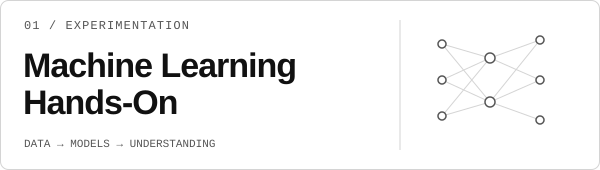
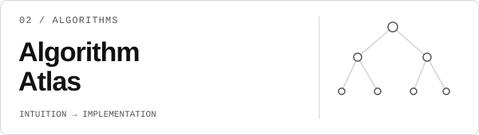
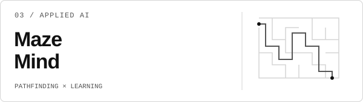
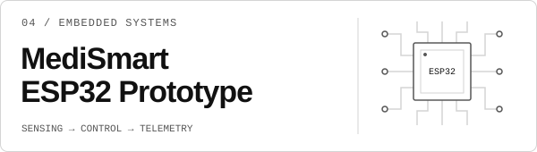
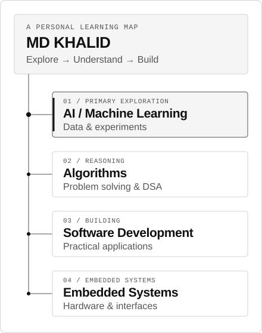

  <picture>
    <source media="(prefers-color-scheme: dark)" srcset="./assets/avatar/kh-identity.svg" />
    
  </picture>

<h1 align="center">MD Khalid Hasan</h1>

  <strong>AI / Machine Learning Explorer</strong> 
  Computer Science &amp; Engineering undergraduate @ UIU · Bangladesh

  <picture>
    <source media="(prefers-color-scheme: dark)" srcset="./animate.svg" />
    
  </picture>

  <a href="#featured-projects">Selected work</a> ·
  <a href="#exploration-map">Exploration map</a> ·
  <a href="#connect">Connect</a>

## About Me

I'm a CSE undergraduate at United International University, learning through implementation, experiments, and practical projects. My main interest is AI and machine learning; I also practice algorithms, full-stack development, and embedded systems. I use coursework as a starting point to build things I can run, inspect, and improve.

## Featured Projects

### 01 / Experimentation — Machine Learning Hands-On

<a href="https://github.com/khalidhasan7343/Machine-Learning-Hands-On">
  <picture>
    <source media="(prefers-color-scheme: dark)" srcset="./assets/projects/machine-learning.svg" />
    
  </picture>
</a>

A growing notebook collection where I explore datasets, train models, and compare what they learn.

- Housing regression with Linear Regression, Ridge, and Lasso, evaluated with MAE, MSE, and R².
- Iris clustering with K-Means and PCA; data exploration with pandas.
- MNIST digit recognition and a dense-network versus CNN comparison on Fashion-MNIST.

`Python` · `pandas` · `scikit-learn` · `TensorFlow / Keras` · `Jupyter`

**[Explore the notebooks →](https://github.com/khalidhasan7343/Machine-Learning-Hands-On)**

### 02 / Algorithms — Algorithm Atlas

<a href="https://github.com/khalidhasan7343/algorithm-atlas">
  <picture>
    <source media="(prefers-color-scheme: dark)" srcset="./assets/projects/algorithm-atlas.svg" />
    
  </picture>
</a>

An educational collection connecting algorithm intuition with explanations, implementations, and tests.

- Python and C++ implementations across sorting, searching, graphs, dynamic programming, and more.
- Lessons with dry runs, complexity analysis, input contracts, and edge-case tests.
- Python-first regression and classification work; a catalog separates implemented topics from the wider ML/AI roadmap.

`Python` · `C++` · `NumPy` · `pytest` · `Markdown / YAML`

**[Browse the atlas →](https://github.com/khalidhasan7343/algorithm-atlas)** · Actively developing

### 03 / Applied AI — Maze Mind

<a href="https://github.com/khalidhasan7343/maze_mind">
  <picture>
    <source media="(prefers-color-scheme: dark)" srcset="./assets/projects/maze-mind.svg" />
    
  </picture>
</a>

A playable maze escape game that connects AI pathfinding with gameplay analysis and a learning pipeline.

- Randomized DFS maze generation and an A* hunter, with classic and isometric Pygame views.
- SQLite records of completed rounds and in-game snapshots for feature engineering and analysis.
- KNN skill classification, K-Means playstyle clustering, and logistic-regression escape estimates.

`Python` · `Pygame CE` · `SQLite` · `scikit-learn` · `pandas`

**[Inspect the game and pipeline →](https://github.com/khalidhasan7343/maze_mind)**

A learning project: bot-simulated training results do not establish accuracy on human players.

### 04 / Embedded Systems — Microprocessor & Microcontroller Project

<a href="https://github.com/khalidhasan7343/CSE_4326_-Microprosser---Micro-controller-_Project">
  <picture>
    <source media="(prefers-color-scheme: dark)" srcset="./assets/projects/embedded-systems.svg" />
    
  </picture>
</a>

**MediSmart** is a university team prototype connecting dual-infusion control and patient monitoring with embedded sensing, actuation, and web dashboards.

- ESP32 firmware in C, using ESP-IDF and FreeRTOS through PlatformIO.
- MAX30102 and AD8232 sensing, HX711 load-cell input, PWM servo control, and a local buzzer.
- Wi-Fi / HTTP JSON exchange with Firebase Realtime Database and HTML/CSS/JavaScript dashboards.

`C` · `ESP32 / ESP-IDF` · `FreeRTOS` · `PlatformIO` · `Firebase`

**[Explore the hardware project →](https://github.com/khalidhasan7343/CSE_4326_-Microprosser---Micro-controller-_Project)** · [Prototype photos](https://github.com/khalidhasan7343/CSE_4326_-Microprosser---Micro-controller-_Project/tree/main/Project_images) · [Technical report](https://github.com/khalidhasan7343/CSE_4326_-Microprosser---Micro-controller-_Project/tree/main/CSE_4326_Project_Paper)

Earlier practice: [Web development mini projects](https://github.com/khalidhasan7343/Basic-Project) · [SQL & database coursework](https://github.com/khalidhasan7343/dbms) · [All repositories →](https://github.com/khalidhasan7343?tab=repositories)

## Exploration Map

AI and machine learning lead my exploration. Four connected directions bring it into practice: data experiments, algorithmic problem solving, software development, and embedded hardware.

  <picture>
    <source media="(prefers-color-scheme: dark)" srcset="./assets/exploration/exploration-map.svg" />
    
  </picture>

## Technical Toolkit

Technologies I've used in coursework and learning projects:

| Area | Toolkit |
| :--- | :--- |
| Programming | C · C++ · Java · Python · JavaScript · SQL |
| Web development | HTML · CSS · Tailwind CSS |
| Data / ML | pandas · scikit-learn · Keras · TensorFlow |
| Developer tools | Git · GitHub · VS Code · Jupyter · Linux |

## Currently Exploring

- **AI / ML:** learning PyTorch and retrieval-augmented generation (RAG).
- **Full-stack development:** exploring Next.js and Docker, connecting React with Node.js / Express, and working with MongoDB and MySQL.

## GitHub Activity

[Follow my contributions and recent work on GitHub →](https://github.com/khalidhasan7343)

## Connect

Open to academic projects, beginner-friendly web collaborations, and Java or C++ projects.

[GitHub](https://github.com/khalidhasan7343) · [LinkedIn](https://www.linkedin.com/in/md-khalid-hasan-0224a9308/) · [Email](mailto:mdkhalidhasan7343@gmail.com)
