<h1 align="center">MD Khalid Hasan</h1>

  <strong>Computer Science Undergraduate · Full-Stack Development · Machine Learning</strong>

  

At UIU, I turn coursework into practical web projects, SQL exercises, and Python notebooks. I'm building my machine-learning foundations from first principles while practicing full-stack development, object-oriented programming, and DSA.

## Featured Projects

### Machine Learning Hands-On

Practical notebooks covering data exploration, regression, classification, clustering, and neural networks. Includes handwritten digit recognition and comparisons of dense and convolutional models.

`Python` `pandas` `scikit-learn` `Keras` `TensorFlow` `Jupyter`

**[View repository →](https://github.com/khalidhasan7343/Machine-Learning-Hands-On)**

### Web Development Mini Projects

Browser-based tools and games, including a calculator, stopwatch, dice roller, and number-guessing game.

`HTML` `CSS` `Tailwind CSS` `JavaScript`

**[View repository →](https://github.com/khalidhasan7343/Basic-Project)**

### SQL & Database Coursework

SQL practice covering joins, aggregation, and subqueries through university-style database exercises.

`SQL`

**[View repository →](https://github.com/khalidhasan7343/dbms)**

[Browse all repositories →](https://github.com/khalidhasan7343?tab=repositories)

## Tech Stack

Technologies I work with in coursework and learning projects:

**Languages:** C · C++ · Java · Python · JavaScript · SQL

**Web:** HTML · CSS · Tailwind CSS

**Data / ML:** pandas · scikit-learn · TensorFlow · Keras

**Tools:** Git · GitHub · VS Code · Linux · Jupyter

## Currently Exploring

`PyTorch` · `Retrieval-Augmented Generation (RAG)` · `Next.js` · `Docker`

I'm also learning full-stack architecture: connecting React interfaces with Node.js and Express backends, and working with MongoDB and MySQL.

## GitHub Activity

[View my contributions and recent activity on GitHub →](https://github.com/khalidhasan7343)

<!-- Optional contribution animation:
     Add a light/dark picture here after a workflow generates and verifies its SVG outputs.
     Keep this section optional; do not reference files that have not been generated.
-->

## Connect

Open to academic projects, beginner-friendly web collaborations, and Java or C++ projects.

  
  
  

